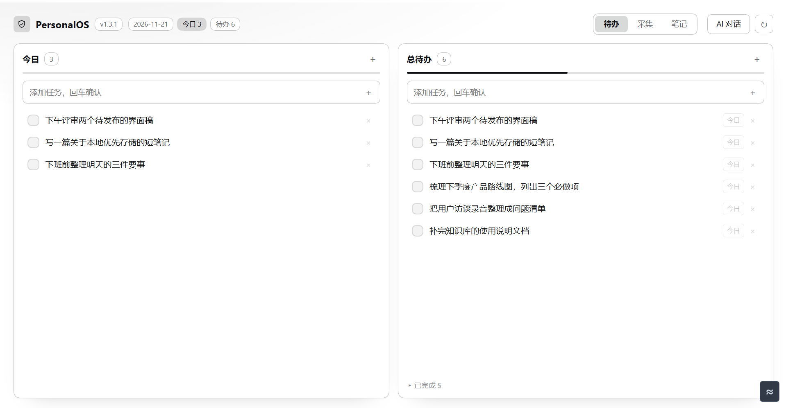

# PersonalOS · 个人任务管理 + 笔记收纳

> 一个工作台，管住你的待办和灵感。

把任务看板和笔记收纳装进 DSH Desktop：左屏是「今日待办 / 任务总清单」双栏看板，随手记下的碎片会自动拆成任务，或按内容归入知识库分类，变成带标题、标签和双向链接的 Markdown 笔记。所有数据都是本地 `.md` 文件，不联网、无遥测，卸载工作台也不会删掉你的内容。



## 能做什么

- **任务看板**：一屏两栏，「今日任务」和「任务总清单」分开记；勾选完成会记下完成时间；总清单里的任务可以一键安排到今天。
- **跨天顺延**：第二天打开时，昨天没勾完的今日任务自动留在今天，已完成的自动并入任务总清单的已完成区。
- **随手采集**：一句话里有多件事会自动拆成多条任务；「今天」「明天」之类的词会决定进今日还是总清单；带链接的内容收成收藏任务。
- **随笔自动分类**：一段想法自动判断该进 AI 技术 / 阅读与认知 / 产业与商业 / 方法论 / 随想 哪个分类，自动起标题、打标签，并写入 Markdown 笔记。
- **笔记收纳**：目录树 + 编辑器，新建、重命名、移动、删除、整理排版，粘贴图片自动存进附件目录。
- **双向链接**：笔记之间用 `[[笔记名]]` 关联，重命名时自动同步其他笔记里的链接。
- **AI 按需对话**：需要时在面板里展开 DSH 原生对话，让 AI 帮你拆任务或整理笔记思路；工作台数据不会自动带入对话。


## 数据放在哪

任务与笔记都是普通文件，写在安装时配置的数据目录里：

```
<数据目录>/
├── 今日任务/未完成.md、已完成.md
├── 任务总清单/未完成.md、已完成.md
├── 知识库/<分类>/<笔记名>.md
├── 知识库/附件/            # 粘贴的图片
└── .personalos/            # 跨天顺延的状态、原始采集记录
```

默认数据目录是 DSH 数据目录下的 `personalos-workbench`。想直接接管已有的 Obsidian 库，把安装配置里的 `root` 改成那个库的绝对路径即可（见 `cordis.patch.yml`）。**卸载工作台不会删除数据目录里的任何文件。**

## 安装

正式上架后，可以直接在 DSH Desktop 的「工作台市场」里搜索 **PersonalOS** 安装。

现阶段用源码安装：

```bash
git clone https://github.com/LeriusLei/dsh-personalos.git
cd dsh-personalos
dsh plugin install ./
```

安装后在侧栏切换到 PersonalOS 工作台即可使用；不需要先建 AI 会话。

## 开发与自测

```bash
node --check dsh/index.js && node --check dsh/store.js && node --check lib/client.js
node scripts/check-package.mjs
node test/store.test.mjs && node test/client.test.mjs && node test/server.test.mjs
```

数据层测试全部在系统临时目录里跑，不会碰真实数据；服务端测试用 mock ctx 校验路由注册与接口行为，不需要启动 DSH。

## 隐私与边界

- 不联网、无遥测：客户端只请求本机的 `/api/personalos-workbench/` 接口。
- 只会读写配置的数据目录，路径越界会被拒绝；不写数据库、不装驱动。
- 仓库里没有任何真实任务、笔记或个人数据。

## License

MIT
